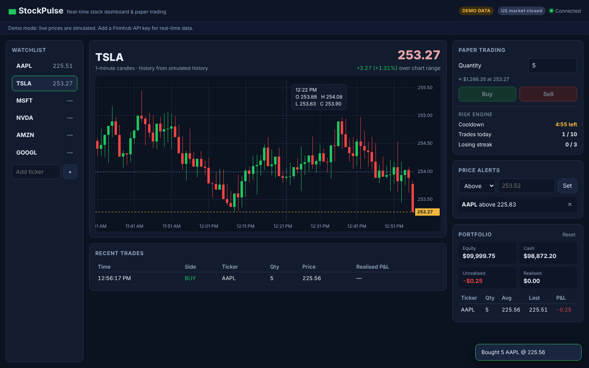

# StockPulse — Real-Time Stock Dashboard & Paper Trading

StockPulse shows live stock prices on a candlestick chart that updates by itself, lets you
practise trading with virtual money, and uses a **behavioural risk engine** (cooldown, daily
limit, auto-halt after losses) to stop impulsive "revenge" trading.



**Stack:** FastAPI · WebSockets · React · Canvas 2D · SQLite · Finnhub API · yfinance · Docker

---

## Features

| Feature | What it does |
|---|---|
| Live prices | Prices are **pushed** to the browser over a WebSocket. No refresh, no polling. |
| Pub-sub rooms | Each ticker has its own subscriber room; you only receive the stock you're watching. A broken connection is dropped without affecting anyone else. |
| 1-minute candles | The `CandleAggregator` groups raw ticks into OHLC (Open, High, Low, Close) candles. |
| Always-on charts | Multi-tier history fallback: saved candles → Finnhub → yfinance → (demo) simulated. |
| Price alerts | Pop-up the moment a stock crosses your target. Each alert fires once. |
| Paper trading | Buy/sell with virtual cash at the live price; positions, average cost, realised & unrealised P&L. |
| Order types | **Market** (fill now), **Limit** (buy at/below, sell at/above a price) and **Stop** (buy at/above, sell at/below). Pending orders wait on the server, are listed under *Open orders* and can be cancelled. |
| Entry / Exit | **Buy · Enter** opens or adds to a position; **Exit position** sells the whole holding in one click (from the trade panel or any portfolio row) and cancels its pending sells. |
| Trailing stop | A stop-loss that follows the price up by a set % and never moves down. |
| Position sizing | *Max* (all your cash), *All* (every share you hold) and *Size*, which picks a quantity so a stop-out loses exactly your chosen % of equity, plus the reward:risk ratio. |
| Chart tools | 1m / 5m / 15m timeframes; SMA 20, EMA 50, Bollinger Bands, VWAP, Volume and RSI 14; lines for entry, stop-loss, target and pending orders. |
| Stop-loss & target | Optional stop-loss and target-profit price on each position (set when buying or edited later). The server checks every tick and sells the whole position automatically, even if no browser is open on that stock. These exits are never blocked by the risk engine. |
| Risk engine | 5-minute cooldown between trades, a daily trade limit, and an automatic halt after 3 losing trades in a row. Enforced **on the server**, so refreshing the page can't bypass it. |
| Validation | Every tick, order and alert is checked with Pydantic schemas; bad data is rejected. |
| Docker | One command runs the whole app. |

---

## Quick start (Docker — easiest)

1. Install **Docker Desktop** and start it.
2. In this folder, copy the settings file:
   - Windows: `copy .env.example .env`
   - macOS / Linux: `cp .env.example .env`
3. *(Optional)* paste a free Finnhub key into `.env` → `FINNHUB_API_KEY=...` for real live prices.
4. Run:
   ```bash
   docker compose up --build
   ```
5. Open **http://localhost:8080**

Without a key the app runs in **DEMO mode**: live ticks are simulated (clearly labelled in the
top bar) while chart history comes from yfinance when your internet allows it.

---

## Run without Docker (for development)

You need **Python 3.10+** and **Node.js 18+**.

**Terminal 1 — backend**
```bash
cd backend
python -m venv .venv
# Windows:  .venv\Scripts\activate
# macOS/Linux:  source .venv/bin/activate
pip install -r requirements.txt
uvicorn app.main:app --reload --port 8000
```
Interactive API docs: http://localhost:8000/docs

**Terminal 2 — frontend**
```bash
cd frontend
npm install
npm run dev
```
Open **http://localhost:5173** (Vite forwards `/api` and `/ws` to the backend).

---

## Getting a free Finnhub key

1. Sign up at https://finnhub.io (free plan).
2. Copy the API key from the dashboard.
3. Put it in `.env`: `FINNHUB_API_KEY=your_key_here` and restart.

The top bar then shows **LIVE · FINNHUB**. Finnhub only streams trades while the US market is open
(about **7:00 p.m.–1:30 a.m. IST**, or 8:00 p.m.–2:30 a.m. when US daylight saving time is off). Outside those hours
the chart shows the last trading session through the fallback.

---

## Configuration (`.env`)

| Variable | Default | Meaning |
|---|---|---|
| `FINNHUB_API_KEY` | *(empty)* | Live data key. Empty → demo mode |
| `DATA_MODE` | `auto` | `auto`, `demo` or `finnhub` |
| `COOLDOWN_SECONDS` | `300` | Wait time after each trade |
| `DAILY_TRADE_LIMIT` | `10` | Max trades per day |
| `MAX_CONSECUTIVE_LOSSES` | `3` | Losing trades in a row before auto-halt |
| `STARTING_CASH` | `100000` | Virtual cash for paper trading |
| `TICKERS` | `AAPL,TSLA,MSFT,NVDA,AMZN,GOOGL` | Default watchlist |

> Tip for a demo: set `COOLDOWN_SECONDS=30` so you can show several trades quickly.

---

## Project structure

```
StockPulse/
├── docker-compose.yml          # runs backend + frontend
├── .env.example                # settings template
├── backend/                    # FastAPI (Python)
│   ├── app/
│   │   ├── main.py             # REST endpoints + /ws WebSocket endpoint
│   │   ├── service.py          # MarketHub: feed → validate → candles → alerts → rooms → DB
│   │   ├── pubsub.py           # PubSubManager: one room per ticker, fault-tolerant sending
│   │   ├── candles.py          # CandleAggregator: ticks → 1-minute OHLC candles
│   │   ├── history.py          # multi-tier history fallback
│   │   ├── trading.py          # PaperTradingEngine + behavioural RiskEngine
│   │   ├── alerts.py           # price alerts
│   │   ├── db.py               # SQLite persistence (async, off the event loop)
│   │   ├── models.py           # Pydantic schemas (validation)
│   │   ├── market.py           # US market hours
│   │   ├── config.py           # settings from .env
│   │   └── feeds/              # finnhub.py (live), demo.py (simulated)
│   └── tests/test_core.py      # unit tests
└── frontend/                   # React (Vite)
    └── src/
        ├── App.jsx             # dashboard layout
        ├── useMarketSocket.js  # one WebSocket, room switching, auto-reconnect
        ├── api.js              # REST calls
        └── components/         # CandleChart (Canvas 2D), Watchlist, TradingPanel,
                                # AlertsPanel, Portfolio, PriceHeader, TradesTable, Toasts
```

### How a price travels (matches Section 3.2 of the report)
1. Finnhub (or the demo feed) sends a trade → `feeds/`
2. It is validated against the `Tick` schema → `models.py`
3. The `CandleAggregator` updates the 1-minute candle → `candles.py`
4. Alerts are checked; the price becomes the paper-trading mark price → `alerts.py`, `service.py`
5. The update is published to that ticker's room → `pubsub.py`
6. The browser redraws the chart → `useMarketSocket.js`, `CandleChart.jsx`
7. Closed candles, alerts and trades are saved in SQLite in the background → `db.py`

---

## API

| Method | Path | Description |
|---|---|---|
| GET | `/api/health` | status, mode, open rooms |
| GET | `/api/config` | watchlist and risk settings |
| GET | `/api/history/{ticker}` | seeded candles + which source was used |
| GET / POST | `/api/alerts` | list / create (`{ticker, target, direction: "above"\|"below"}`) |
| DELETE | `/api/alerts/{id}` | delete an alert |
| GET | `/api/portfolio` | cash, positions, P&L, risk status |
| POST | `/api/orders` | `{ticker, side: "buy"\|"sell", quantity}` → 409 with a reason if the risk engine blocks it |
| GET | `/api/trades` | recent trades |
| POST | `/api/account/reset` | reset the virtual account |

**WebSocket `/ws`**
```
→ {"type": "subscribe",   "ticker": "AAPL"}   ← {"type": "history", "candles": [...], "source": "yfinance"}
                                              ← {"type": "tick", "price": 230.1, "candle": {...}}   (live)
                                              ← {"type": "candle", "final": true, ...}              (minute closed)
→ {"type": "unsubscribe", "ticker": "AAPL"}
← {"type": "alert", "alert": {...}}   ← {"type": "status", "mode": "demo", "market_open": false}
```

---

## Tests

```bash
cd backend
python -m unittest -v        # or: pytest
```
Covers the candle aggregator (including the worked example from the report), the risk engine
(cooldown, daily limit, auto-halt), paper trading, pub-sub room isolation and fault tolerance,
alerts, and the full data path through `MarketHub`.

---

## Demo script (2 minutes)

1. Open the dashboard; point out the badge (DEMO / LIVE) and the market status.
2. Hover over the chart to show a candle's Open / High / Low / Close.
3. Click **TSLA** in the watchlist (the app unsubscribes from AAPL's room and joins TSLA's).
4. Set an alert just above the current price and wait for the pop-up.
5. **Buy** 5 shares, then try to trade again → the risk engine blocks it and shows the cooldown.

---

## Troubleshooting

| Problem | Fix |
|---|---|
| Chart says "No price history available" | yfinance couldn't be reached. Live/demo candles still appear within a minute. |
| Top bar shows "Reconnecting…" | The backend isn't running on port 8000. |
| No live movement with a Finnhub key | The US market is closed; prices resume at the open. |
| `docker compose` not found | Update Docker Desktop, or use `docker-compose up --build`. |
| Port 8080 already in use | Change `"8080:80"` in `docker-compose.yml`, e.g. `"3000:80"`. |

Limitations (by design for a prototype): single backend instance, SQLite, market orders only,
no brokerage/slippage, US stocks only. See Chapter 6 of the report for the scaling plan.
